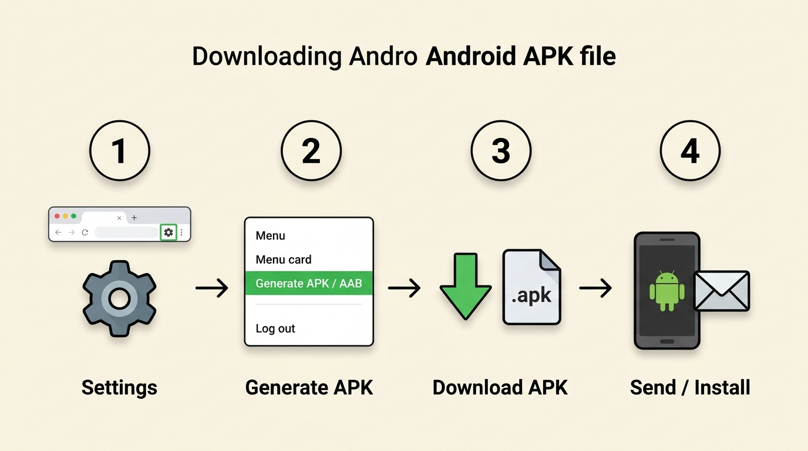

# 「오늘 약·물」 APK 파일 다운로드 및 스마트폰 설치 안내

처음 앱을 만들어 보시는 분도 순서대로 따라 하실 수 있도록 **APK(안드로이드 설치 파일)를 내려받는 방법**과 **스마트폰에 설치하는 방법**을 정리했습니다.

---

## 방법 1. AI Studio 설정 메뉴에서 바로 APK 다운로드하기 (가장 쉬운 방법)



별도의 프로그램을 설치하지 않고 지금 보고 계신 AI Studio 화면에서 바로 APK 파일을 받을 수 있습니다.

1. AI Studio 화면 상단(또는 프로젝트 메뉴)의 **설정(Settings)** 메뉴를 엽니다.
2. 메뉴 안에서 **APK / AAB 생성(내보내기)** 항목을 찾습니다.
3. **APK** 생성을 선택해 빌드가 완료될 때까지 잠시 기다립니다.
4. 빌드가 끝나면 **다운로드** 버튼을 눌러 내 컴퓨터(또는 현재 기기)에 `.apk` 파일을 저장합니다.
5. 저장된 `.apk` 파일을 열어 이메일(`ultrakim7@gmail.com` 등)에 첨부해 보내거나 스마트폰으로 옮깁니다.

---

## 방법 2. 프로젝트를 ZIP으로 내려받아 내 컴퓨터에서 APK 만들기

> **참고:** 현재 프로젝트 안에 생성된 디버그 APK 파일 위치는 `app/build/outputs/apk/debug/app-debug.apk`입니다.  
> 하지만 프로젝트의 `app/.gitignore` 설정에 `/build` 폴더가 제외되어 있어, **프로젝트 전체를 ZIP으로 내보내기(Export as ZIP)** 하면 `build` 폴더가 포함되지 않을 수 있습니다.

ZIP으로 내려받은 소스코드에서 APK를 직접 생성하려면 아래 순서대로 진행하세요.

### A. Android Studio(안드로이드 스튜디오)로 만들기
1. AI Studio 메뉴에서 **ZIP으로 내보내기(Export as ZIP)** 를 선택해 압축 파일을 내려받습니다.
2. 내려받은 ZIP 파일의 압축을 풉니다.
3. **Android Studio**를 실행하고 **Open**을 눌러 압축을 푼 폴더를 엽니다.
4. 상단 메뉴에서 **Build → Build Bundle(s) / APK(s) → Build APK(s)** 를 클릭합니다.
5. 오른쪽 아래 알림창에 `APK(s) generated successfully`가 뜨면 **locate** 글자를 누릅니다.
6. 열린 폴더 안에 있는 **`app-debug.apk`** 파일이 설치용 APK 파일입니다.

### B. 터미널(명령 프롬프트)로 만들기
1. 압축을 푼 프로젝트 최상위 폴더에서 터미널을 엽니다.
2. 아래 명령어를 실행합니다.
   - Mac / Linux: `./gradlew :app:assembleDebug`
   - Windows: `gradlew.bat :app:assembleDebug`
3. 빌드가 끝나면 아래 경로에서 APK 파일을 찾을 수 있습니다.
   - `app/build/outputs/apk/debug/app-debug.apk`

---

## 방법 3. GitHub 자동 빌드로 웹에서 바로 APK 받기 (PC 프로그램 설치 불필요)

AI Studio에서 GitHub로 바로 푸시한 뒤, GitHub 웹사이트에서 빌드 설정을 한 번만 추가하면 브라우저에서 APK를 받을 수 있습니다.

1. AI Studio 상단의 **GitHub 아이콘(고양이 모양)** 을 눌러 내 GitHub 저장소로 프로젝트를 올립니다(Push).
2. 방금 올린 GitHub 저장소 페이지 상단의 **Actions** 탭을 클릭합니다.
3. 화면의 **set up a workflow yourself** (직접 워크플로 설정) 글자를 누릅니다.  
   *(또는 Code 탭 → **Add file → Create new file** 을 누르고 파일 이름 칸에 `.github/workflows/build-apk.yml` 을 입력합니다.)*
4. 편집창에 아래 내용을 전부 지운 뒤 그대로 붙여넣습니다.

```yaml
name: Build Android APK

on:
  push:
  workflow_dispatch:

jobs:
  build-apk:
    name: Build Debug APK
    runs-on: ubuntu-latest

    steps:
      - name: Checkout repository
        uses: actions/checkout@v4

      - name: Set up JDK 17
        uses: actions/setup-java@v4
        with:
          distribution: temurin
          java-version: '17'

      - name: Set up Gradle 9.3.1
        uses: gradle/actions/setup-gradle@v4
        with:
          gradle-version: '9.3.1'

      - name: Restore debug keystore
        run: |
          if [ ! -f debug.keystore ] && [ -f debug.keystore.base64 ]; then
            base64 -d debug.keystore.base64 > debug.keystore
          elif [ ! -f debug.keystore ]; then
            keytool -genkeypair -v -keystore debug.keystore \
              -storepass android -alias androiddebugkey -keypass android \
              -keyalg RSA -keysize 2048 -validity 10000 \
              -dname "CN=Android Debug,O=Android,C=US"
          fi

      - name: Build Debug APK
        run: gradle :app:assembleDebug --no-daemon

      - name: Upload APK Artifact
        uses: actions/upload-artifact@v4
        with:
          name: today-med-water-apk
          path: app/build/outputs/apk/debug/app-debug.apk
          if-no-files-found: error
```

5. 오른쪽 위 초록색 **Commit changes...** 버튼을 두 번 눌러 저장합니다.
6. 다시 **Actions** 탭을 누르고 맨 위 **Build Android APK** 실행 항목을 클릭합니다. *(보통 2~3분 걸리며, 초록색 체크 표시가 뜨면 완료입니다.)*
7. 화면 아래 **Artifacts** 영역에 있는 **`today-med-water-apk`** 를 클릭해 내려받은 뒤 ZIP 압축을 풀면 **`app-debug.apk`** 파일이 나옵니다.

---

## 보너스: 받은 APK 파일을 스마트폰에 설치하는 방법

다운로드한 `.apk` 파일을 안드로이드 스마트폰에 설치하려면 다음 순서를 따라 하세요.

1. **스마트폰으로 파일 옮기기**
   - 이메일(`ultrakim7@gmail.com`)에 `.apk` 파일을 첨부해 본인에게 보낸 뒤 스마트폰 메일 앱에서 첨부파일을 내려받거나,
   - 카카오톡 **나와의 채팅**, Google 드라이브, 또는 USB 케이블을 이용해 스마트폰의 **Download(다운로드)** 폴더에 복사합니다.
2. **APK 파일 실행하기**
   - 스마트폰의 **내 파일(Files)** 앱에서 방금 받은 `.apk` 파일을 터치합니다.
3. **보안 허용 안내가 나올 때**
   - 스토어가 아닌 직접 받은 파일이므로 *"보안을 위해 이 출처의 알 수 없는 앱을 휴대전화에 설치할 수 없습니다"* 라는 안내가 나올 수 있습니다.
   - 안내창의 **설정** 버튼을 누른 뒤 **이 출처 허용** 스위치를 켜고 뒤로 돌아갑니다.
4. **설치 완료**
   - **설치** 버튼을 누르면 잠시 후 설치가 완료됩니다.
   - 스마트폰 홈 화면 또는 앱 목록에서 **「오늘 약·물」** 아이콘을 눌러 바로 사용하실 수 있습니다.
